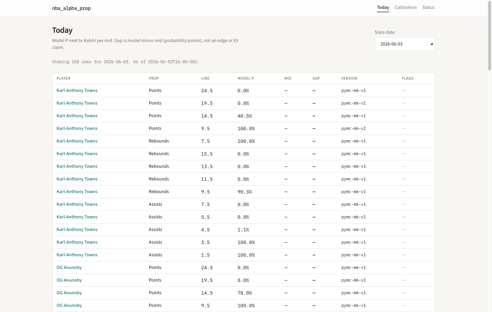
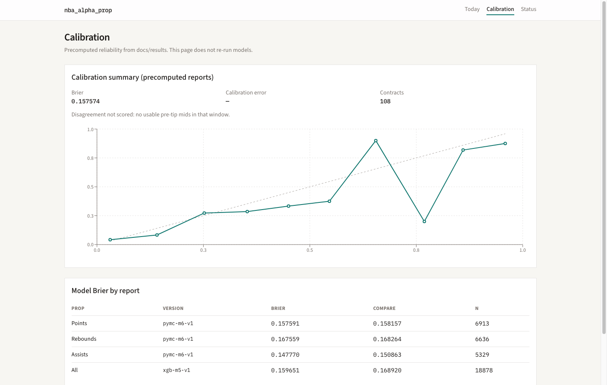
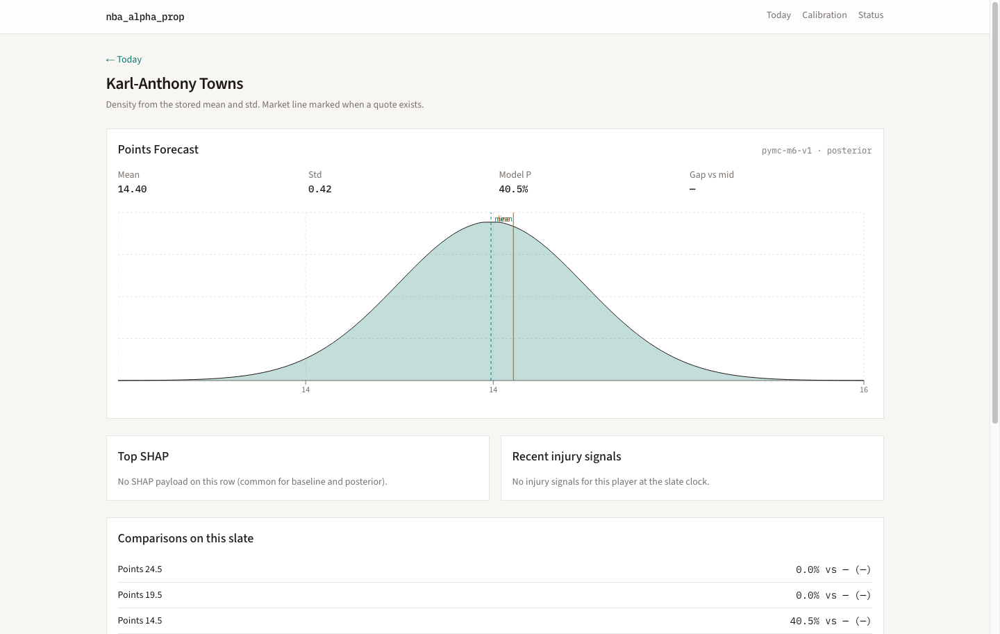
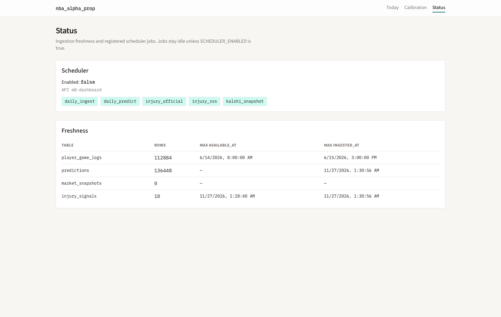

# nba_alpha_prop

Portfolio forecasting system for NBA player props. It ingests box scores and
Kalshi markets with point-in-time clocks, forecasts points / rebounds /
assists (XGBoost + hierarchical Bayesian + lineup adjustments), and shows
model probability next to the market mid. No bets, no EV claims.

## Screenshots

| Today | Calibration |
| --- | --- |
|  |  |

| Player detail | Status |
| --- | --- |
|  |  |

## Stack

- **API:** Python 3.12, FastAPI, SQLModel, Alembic, Postgres, APScheduler
- **Models:** XGBoost (`xgb-m5-v1`), PyMC (`pymc-m6-v1`), lineup shifts (`lineup-m7-v1`)
- **UI:** Next.js 16, TanStack Query, Recharts
- **Deploy:** Railway (API + Postgres), Vercel (frontend), GitHub Actions CI

## Docs

| Doc | What it is |
| --- | --- |
| [docs/architecture.md](docs/architecture.md) | System design (start here for interviews) |
| [docs/model_card.md](docs/model_card.md) | Intended use and limits |
| [docs/status.md](docs/status.md) | What the tree actually contains |
| [docs/adr.md](docs/adr.md) | Decision records |
| [docs/results/](docs/results/) | Calibration / Brier reports that closed milestones |
| [docs/provenance/](docs/provenance/) | Why each milestone looked the way it did |

## Local run

Postgres up, `DATABASE_URL` set (see `backend/.env.example`):

```bash
# API
cd backend
uv sync
uv run alembic upgrade head
uv run uvicorn app.main:app --reload --port 8000

# UI (separate terminal)
cd frontend
cp .env.example .env.local   # NEXT_PUBLIC_API_BASE_URL=http://127.0.0.1:8000
npm install
npm run dev
```

Open http://127.0.0.1:3000. Keep `SCHEDULER_ENABLED` off unless you want
cron jobs. `GET /health` should return `{"status":"ok"}`.

## Scope

- Three props, NBA only. Gap = model P − market mid. Not edge.
- Feature clock: `event_time < as_of` and `available_at <= as_of`.
- Discord alerts (M9) are optional and not required for the portfolio story.

## License

MIT.

## About

Ronnie Wang · undergrad portfolio project · wronnie@seas.upenn.edu
