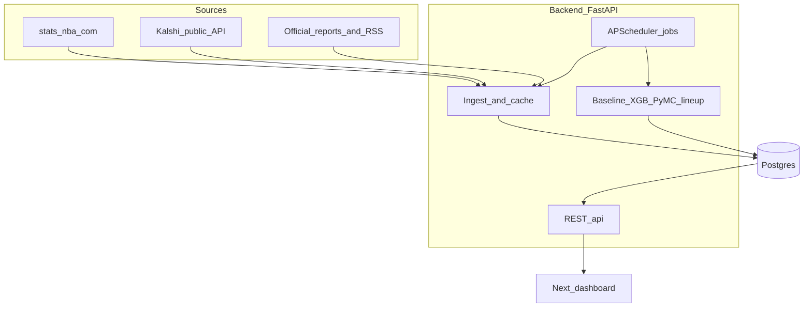

# Architecture

How `nba_alpha_prop` is put together, and why. This is the document to walk
a recruiter through: clocks, data, models, API, and the dashboard.

## One-sentence system

Ingest NBA box scores and Kalshi prop markets into Postgres with honest
point-in-time clocks, forecast player counting stats with XGBoost plus a
hierarchical Bayesian wrapper, adjust teammates when injury news says a
starter is out, then show model probability next to the market mid.

## Design commitments

Three rules show up in code and reviews.

1. **Point-in-time correctness.** A feature query at simulated time `as_of`
   may only see facts with `event_time < as_of` and `available_at <= as_of`.
   `ingested_at` records when this system fetched a row. It is not the
   feature filter for box scores.
2. **Lineup-conditional projections.** Injury claims do not apply a
   hand-tuned points penalty. They trigger a redistribution layer fit on
   historical games where a usual starter was missing.
3. **Hybrid forecast.** A booster owns the rich mean. A Bayesian layer
   owns uncertainty and pooling. The dashboard compares a probability to
   a Kalshi mid. It does not claim expected value or place bets.

## Context diagram

## Data and clocks

### Identity and facts

| Table | Role |
| --- | --- |
| `players`, `teams` | Stable NBA ids |
| `games`, `game_results` | Schedule and final scores |
| `player_game_logs` | Per-player box scores; optional `started` from traditional box scores |
| `markets`, `market_snapshots`, `market_settlements` | Kalshi props, book, outcomes |
| `kalshi_player_aliases` | Name → `player_id` |
| `predictions` | One forecast row per `(player, game, prop, model_version)` |
| `injury_signals` | Classified news with the same clocks as box scores |
| `request_cache` | Cached upstream HTTP bodies |

### Why two clocks on box scores

Bulk history is loaded long after the game. If features filtered only on
`ingested_at`, a 2024 game loaded in 2026 would be invisible to a 2025
backtest, or visible too late depending on how you cheat. `available_at`
is the reconstructed "when a careful system could have known": noon UTC
the day after `game_date` for bulk loads, fetch time for live loads.
Feature code uses `query_player_game_logs(..., as_of=...)`.

Market quotes keep `quoted_at` and `ingested_at`. A mid is
`(yes_bid + yes_ask) / 2` when both sides exist.

### Ingest path

- NBA: direct HTTP to `stats.nba.com` through `curl_cffi` (Chrome TLS
  fingerprint). `LeagueGameLog` for bulk and daily box scores.
  `boxscoretraditionalv2` for `START_POSITION` backfill.
- Kalshi: public REST only. No trading keys.
- Injury: official reports via `nbainjuries` when JVM works; ESPN RSS and
  a Bleacher Report sitewide feed filtered for NBA. Claude Haiku returns
  structured JSON into `injury_signals`.

Outbound calls go through a Postgres-backed cache so rate limits and
reruns do not hammer upstream.

## Modeling stack

Versions coexist. A later model is a new `model_version`, never an
overwrite of an earlier one.

| Version | What it is |
| --- | --- |
| `baseline-m3-v1` | Rolling-mean baseline; daily job still writes this |
| `xgb-m5-v1` | Ten box-score features, residual normal for P(stat ≥ line) |
| `pymc-m6-v1` | Hierarchical posterior around the booster (per prop) |
| `lineup-m7-v1` | Additive teammate shifts when a starter is out |

### XGBoost (M5)

Holdout is a cut on `game_date`, not random folds. Features come from
columns that exist under the clocks (rolling points/rebounds/assists,
minutes, home, capped rest, usage proxy, opponent points allowed, days
since a big scoring night). Lineup and true pace were refused when the
tables did not support them. SHAP top-5 lives on the prediction payload
when the booster row exists.

### Posterior (M6)

Per prop: normal left-censored at 0 around a location built from the
booster mean and a player intercept. Points and rebounds keep a free
`beta` with an orthogonal intercept; assists fixes `beta = 1` after a
free slope absorbed into the intercepts. Stored rows are summary stats;
traces are NetCDF under `models/` (gitignored). Scoring averages the
upper tail over draws when the trace is present; the API density chart
uses the stored mean and std so the dashboard does not require the
trace file.

### Injury and lineup (M7)

Training labels: who started (`START_POSITION`). Usual starter = started
in at least 6 of the prior 10 team games. Effects are shrunk mean
differences for `(injured, beneficiary, prop)`.

Live trigger: classified Out/Doubtful signals. The Embiid → Maxey
acceptance test asserts a fitted positive points lift, not a constant.

## API and dashboard

FastAPI serves:

- `GET /api/comparisons/today` — model P vs Kalshi mid, signed **gap**
- `GET /api/players/{id}/detail` — density, SHAP, injuries
- `GET /api/calibration/summary` — precomputed bins and Briers from
  `docs/results/`
- `GET /api/status` — freshness and registered job ids
- `GET /health`

Display preference for a cell: `lineup-m7-v1` → `pymc-m6-v1` →
`xgb-m5-v1` → `baseline-m3-v1`.

Next.js (App Router) + TanStack Query + Recharts. Copy says disagreement
and gap, not edge or EV. Slate date defaults to the latest date with both
predictions and markets. Pre-tip schedule ingest is still incomplete;
the dashboard is slate-based, not tip-clock based.

## Scheduling and deploy

APScheduler runs inside the FastAPI process when `SCHEDULER_ENABLED=true`:
daily NBA ingest, daily baseline predict, Kalshi snapshots, injury
official hourly, injury RSS every 15 minutes. Default is off so tests and
local uvicorn stay quiet. Milestone proofs are timed commands, not live
ticks.

Deploy:

- **API + Postgres:** Railway (`backend/Dockerfile`, Python 3.12 slim,
  `g++` and JRE for `jpype1` / `nbainjuries`)
- **Frontend:** Vercel
- **CI:** GitHub Actions for lint, types, tests

## What this architecture is not

- Not a betting engine. No bankroll, no stake sizing, no EV claims in
  product language.
- Not a full pre-tip production forecaster yet. Daily writes are still
  baseline; richer versions are stored and shown when present.
- Not a research kitchen sink. Deferred items (PBP bulk, Twitter, Discord
  alerts) stay out until a milestone asks for them.

## Where to read next

| Doc | Use |
| --- | --- |
| `docs/adr.md` | Decisions (schema, TLS, Kalshi, posterior, lineup) |
| `docs/provenance/` | Why a milestone looked the way it did |
| `docs/results/` | Numbers that closed M4–M7 |
| `docs/model_card.md` | Intended use and limits |
| `docs/status.md` | What the tree actually contains right now |
