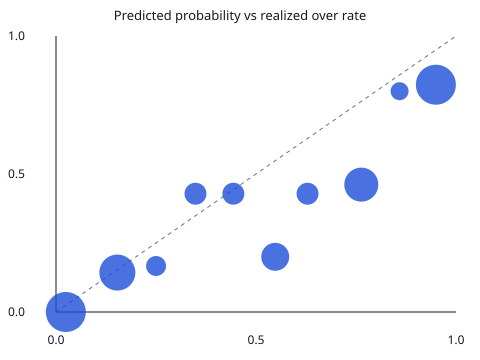

# Baseline replay 2026-06-03 to 2026-06-13

Model version: `baseline-m3-v1`.

This is the rolling-mean baseline.
It is not the XGBoost model and not the Bayesian posterior.

Features use `query_player_game_logs` at 16:00 UTC on the game date.
Both `event_time` and `ingested_at` have to fall before that clock.
A bulk load whose `ingested_at` is the fetch day will not be visible
to a replay set before that fetch.

Games in range: 5
Kalshi-resolved players in the database: 148
Forecasts scored: 168
No row visible at 16:00 UTC: 6 player-props. These players may have history. It was ingested after the clock.
Visible history shorter than 5 games: 0 player-props.
Skipped (prior team not in this game): 6
MAE: 3.548 on 168 player-props
Hit rate: 73/105 = 0.695. A hit is agreement. The mean and the stat are both >= the line, or both below it.
Predicted over (mean >= line): 29/52 = 0.558.
Predicted under (mean < line): 44/53 = 0.830.
Games with a scored contract: 1 (2026-06-03).
Days from the newest visible game to the game being scored, on player-props that had a line: 416 to 476.

MAE counts each player-prop with a forecast, including games with no line.
Hit rate counts each distinct Kalshi line once.
Brier and log loss count each Kalshi contract once.
All three are conditional on the player appearing in the box score.

Brier score: 0.177592 on 105 contracts. Mean squared error of P(stat >= line) against the 0/1 outcome.
Log loss: 0.522516 on 105 contracts. Probabilities are clipped to [1e-06, 0.999999] before the logarithm. Brier uses the unclipped probability.
P(stat >= line) is the upper tail of the normal stored on the prediction. That normal is the M3 placeholder, not a posterior.
Calibration error: 0.124035. Count-weighted mean absolute gap between the realized over rate and the mean predicted probability in the bin. Empty bins are left out.

Equal-width bins on [0, 1]. The last bin includes 1.

| bin | n | mean predicted | realized over rate |
| --- | --- | --- | --- |
| 0.0 to 0.1 | 19 | 0.025 | 0.000 |
| 0.1 to 0.2 | 14 | 0.153 | 0.143 |
| 0.2 to 0.3 | 6 | 0.250 | 0.167 |
| 0.3 to 0.4 | 7 | 0.349 | 0.429 |
| 0.4 to 0.5 | 7 | 0.443 | 0.429 |
| 0.5 to 0.6 | 10 | 0.548 | 0.200 |
| 0.6 to 0.7 | 7 | 0.629 | 0.429 |
| 0.7 to 0.8 | 13 | 0.763 | 0.462 |
| 0.8 to 0.9 | 5 | 0.859 | 0.800 |
| 0.9 to 1.0 | 17 | 0.950 | 0.824 |

Quoted mids at or before 16:00 UTC: 0.
Contracts with no usable pre-tip quote: 105.
The quote is (yes_bid + yes_ask) / 2 from the latest snapshot whose quoted_at and ingested_at are both at or before the prediction clock. A one-sided or crossed book is skipped. last_price is not the quote.
Disagreement: not scored. No contract had a model probability different from a visible mid.
