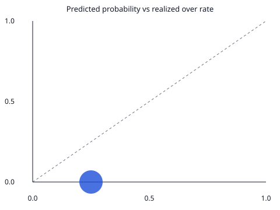

# Baseline replay 2026-01-01 to 2026-01-07

SYNTHETIC. Five players, seven days, one contract each, typed in so the probability section can be checked without a database. These are not NBA games and not a track record.

Model version: `baseline-m3-v1`.

This is the rolling-mean baseline.
It is not the XGBoost model and not the Bayesian posterior.

Features use `query_player_game_logs` at 16:00 UTC on the game date.
Both `event_time` and `ingested_at` have to fall before that clock.
A bulk load whose `ingested_at` is the fetch day will not be visible
to a replay set before that fetch.

Games in range: 7
Kalshi-resolved players in the database: 5
Forecasts scored: 35
Abstained (fewer than 5 prior games): 0
Skipped (prior team not in this game): 0
MAE: 2.000 on 35 player-props
Hit rate: 35/35 = 1.000. Over means predicted mean >= line and actual stat >= line.

MAE counts each player-prop once.
Hit rate counts each distinct Kalshi line once.
Brier and log loss count each Kalshi contract once.
All three are conditional on the player appearing in the box score.
A handful of games is a sample. The held-out month is a separate check.

Brier score: 0.062500 on 35 contracts. Mean squared error of P(stat >= line) against the 0/1 outcome.
Log loss: 0.287682 on 35 contracts. Probabilities are clipped to [1e-06, 0.999999] before the logarithm. Brier uses the unclipped probability.
P(stat >= line) is the upper tail of the normal stored on the prediction. That normal is the M3 placeholder, not a posterior.
Calibration error: 0.250000. Count-weighted mean absolute gap between the realized over rate and the mean predicted probability in the bin. Empty bins are left out.

Equal-width bins on [0, 1]. The last bin includes 1.

| bin | n | mean predicted | realized over rate |
| --- | --- | --- | --- |
| 0.0 to 0.1 | 0 |  |  |
| 0.1 to 0.2 | 0 |  |  |
| 0.2 to 0.3 | 35 | 0.250 | 0.000 |
| 0.3 to 0.4 | 0 |  |  |
| 0.4 to 0.5 | 0 |  |  |
| 0.5 to 0.6 | 0 |  |  |
| 0.6 to 0.7 | 0 |  |  |
| 0.7 to 0.8 | 0 |  |  |
| 0.8 to 0.9 | 0 |  |  |
| 0.9 to 1.0 | 0 |  |  |

Quoted mids at or before 16:00 UTC: 0.
Contracts with no usable pre-tip quote: 35.
The quote is (yes_bid + yes_ask) / 2 from the latest snapshot whose quoted_at and ingested_at are both at or before the prediction clock. A one-sided or crossed book is skipped. last_price is not the quote.
Disagreement: not scored. No contract had a model probability different from a visible mid.
