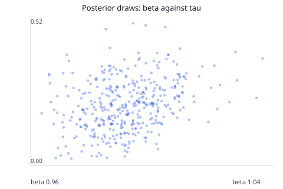

# M6 rebounds posterior, diagnostic subset

This is a seeded 40-player NUTS run.
It is not the acceptance fit. The milestone stays open.

No prediction row was written.
`baseline-m3-v1` and `xgb-m5-v1` were not changed.

The holdout booster is trained on every training date and no holdout date.
The sampler's training rows are the subset only.
Holdout labels were not used to update a player intercept.
The player intercept is non-centered. Alpha equals tau times a standard normal.
The likelihood is a normal left-censored at 0. A positive observation uses the normal density. A zero uses the probability of the latent normal falling at or below 0. The width is the shared sigma. The priors on beta, tau, and sigma are unchanged. For a line above 0, the scored probability is the latent upper tail. The player intercept is the part of the non-centered draw with no slope on that player's mean booster prediction. That slope is zero in every draw, so a correlation of beta with it is not a finding.
The sampler's booster prediction comes from 5 expanding date blocks inside the training period. Each block is predicted by a booster fit only on earlier blocks. The earliest block is left out. Subset training rows with a prediction: 4001 of 5006. Holdout rows use the booster trained on every training date.

Holdout starts: 2025-12-05.
Subset players: 40. Seed: 0. Chains: 4. Tune: 1000. Draws: 2000. Target accept: 0.9.
Player ids: 202691, 203937, 203944, 1626192, 1627739, 1628418, 1628991, 1629006, 1629028, 1629599, 1629614, 1629680, 1630171, 1630191, 1630209, 1630552, 1630560, 1630581, 1630590, 1630625, 1631106, 1631120, 1631132, 1641712, 1641731, 1641764, 1641767, 1641809, 1641989, 1642262, 1642272, 1642281, 1642403, 1642404, 1642502, 1642844, 1642845, 1642852, 1642920, 1642948.
Subset training rows: 4001. Subset headline holdout rows: 1655.
M5 residual width, fit on all training rows: 2.509.

Brier is only the headline contracts of this subset.
A lower number on a subset does not close the milestone.
Residual-band Brier: 0.185995 on 509 contracts.
Posterior Brier: 0.185606 on 509 contracts.
Rebounds MAE, XGBoost clipped mean: 1.943 on 1655 player-props.
Rebounds MAE, posterior predictive mean: 1.939 on 1655 player-props.

Divergences: 0.
Population parameters, unrounded, printed to 4 decimals:
- `beta` R-hat 1.0009, bulk ESS 5297.6.
- `sigma` R-hat 1.0003, bulk ESS 13271.5.
- `tau` R-hat 1.0010, bulk ESS 1375.0.
The gate reads the unrounded R-hat and ESS. A non-finite value fails. Zero divergences are required.
The diagnostic gate passed for this subset.

Blue bars are observed rebounds. Amber bars are the mean posterior predictive count.
The first bin is every value below 0. The last bin is every value at or above 30.
The bins between them are 2 wide.

Correlation of beta and tau: 0.238.
Mean beta: 0.993.
Mean slope of the player intercepts on the player's mean booster prediction: -0.000.
Correlation of beta with that slope: not defined.
The correlation of beta with the intercept slope is not defined.
The trace is `models/m6-rebounds-orthogonal-oof.nc`. That file is gitignored.
Earlier traces under `models/` are left in place.
