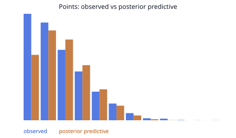

# M6 points posterior, diagnostic subset

This file is the 9 Nov 2026 run. It was not regenerated after the review.
The generator now prints the seed, chain count, tune, draws, and target accept of the run it actually made, and it keeps predictive mass below 0. This file is the earlier text.

That run was 40 players, seed 0, 2 chains, 400 tune steps, 400 draws, target accept 0.9.
The R-hat figures below are ArviZ's default 2-decimal rounding, printed with four digits. `1.0100` is the rounded value 1.01.
The training covariate was the booster's prediction of the same row it was trained on. Holdout rows used the booster trained only on earlier dates.
The figure drops every value below 0 and every value at or above 60. It was not redrawn.

This is a seeded 40-player NUTS run. It is not the acceptance fit.
The milestone stays open.

No prediction row was written.
`baseline-m3-v1` and `xgb-m5-v1` were not changed.

The booster was refit on every training row before the holdout.
The sampler's training rows are the subset only.
Holdout labels were not used to update a player intercept.

Holdout starts: 2025-12-05.
Subset players: 40. Seed: 0.
Player ids: 202691, 203937, 203944, 1626192, 1627739, 1628418, 1628991, 1629006, 1629028, 1629599, 1629614, 1629680, 1630171, 1630191, 1630209, 1630552, 1630560, 1630581, 1630590, 1630625, 1631106, 1631120, 1631132, 1641712, 1641731, 1641764, 1641767, 1641809, 1641989, 1642262, 1642272, 1642281, 1642403, 1642404, 1642502, 1642844, 1642845, 1642852, 1642920, 1642948.
Subset training rows: 5006. Subset headline holdout rows: 1655.
M5 residual width, fit on all training rows: 6.002.

Brier is only the headline contracts of this subset.
A lower number here does not close the milestone.
Residual-band Brier: 0.163925 on 581 contracts.
Posterior Brier: 0.163713 on 581 contracts.

Divergences: 0.
Population parameters:
- `beta` R-hat 1.0100, bulk ESS 233.0.
- `sigma` R-hat 1.0000, bulk ESS 412.0.
- `tau` R-hat 1.0900, bulk ESS 28.0.
The diagnostic gate on beta, sigma, and tau did not pass.

Blue bars are observed points. Amber bars are the mean posterior predictive count.
Bins are 5 points wide, from 0 up to 60. Values outside that range are absent from this figure.
