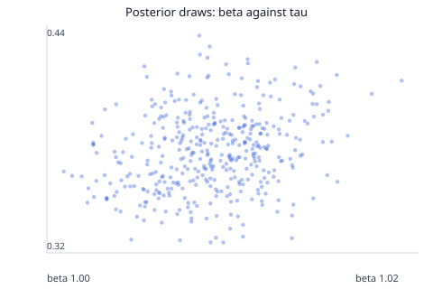

# M6 rebounds posterior

This is the rebounds acceptance sample, 753 players in the likelihood.
Points and assists are not in this fit.

`pymc-m6-v1` rows written for the scored holdout: 1328.
`baseline-m3-v1` and `xgb-m5-v1` were not changed.

The holdout booster is trained on every training date and no holdout date.
The sampler's training rows are the out-of-fold rows of the players in the likelihood.
Holdout labels were not used to update a player intercept.
The player intercept is non-centered. Alpha equals tau times a standard normal.
The likelihood is a normal left-censored at 0. A positive observation uses the normal density. A zero uses the probability of the latent normal falling at or below 0. The width is the shared sigma. The priors on beta, tau, and sigma are unchanged. For a line above 0, the scored probability is the latent upper tail. The player intercept is the part of the non-centered draw with no slope on that player's mean booster prediction. That slope is zero in every draw, so a correlation of beta with it is not a finding.
The sampler's booster prediction comes from 5 expanding date blocks inside the training period. Each block is predicted by a booster fit only on earlier blocks. The earliest block is left out. Subset training rows with a prediction: 66986 of 86759. Holdout rows use the booster trained on every training date.

Holdout starts: 2025-12-05.
Subset players: 753. Seed: 0. Chains: 4. Tune: 1000. Draws: 2000. Target accept: 0.9.
Players in the sampler: 753.
Subset training rows: 66986. Subset headline holdout rows: 20757.
M5 residual width, fit on all training rows: 2.509.

Brier is every headline rebounds contract.
The M5 figure of 0.159651 is 18878 contracts across points, rebounds, and assists.
Residual-band Brier: 0.168264 on 6636 contracts.
Posterior Brier: 0.167559 on 6636 contracts.
Rebounds MAE, XGBoost clipped mean: 1.920 on 20757 player-props.
Rebounds MAE, posterior predictive mean: 1.910 on 20757 player-props.

Divergences: 0.
Population parameters, unrounded, printed to 4 decimals:
- `beta` R-hat 1.0010, bulk ESS 3840.0.
- `sigma` R-hat 1.0016, bulk ESS 9965.9.
- `tau` R-hat 1.0009, bulk ESS 1969.5.
The gate reads the unrounded R-hat and ESS. A non-finite value fails. Zero divergences are required.
The gate passed.

Blue bars are observed rebounds. Amber bars are the mean posterior predictive count.
The first bin is every value below 0. The last bin is every value at or above 30.
The bins between them are 2 wide.

Correlation of beta and tau: 0.206.
Mean beta: 1.006.
Mean slope of the player intercepts on the player's mean booster prediction: -0.000.
Correlation of beta with that slope: not defined.
The correlation of beta with the intercept slope is not defined.
The trace is `models/m6-rebounds-orthogonal-acceptance.nc`. That file is gitignored.
Earlier traces under `models/` are left in place.
